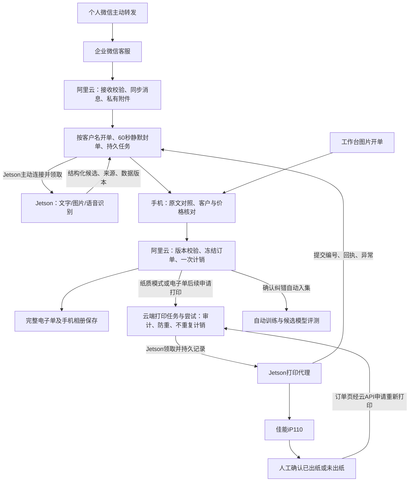

# 店内打单系统：前期规划与产品架构

版本：v0.1-r2（补充旧工程复用评估）；日期：2026-10-30；状态：已记录此前明确决定，新增复用证据未改变已确认业务范围，尚未作为已确认版本上传。

本稿按本次请求维护可编辑规划。第2、4、5、6、9、11节已依据用户本轮决定修改；初稿中与这些决定冲突的建议不再适用。旧清单和截图作为资产与界面参考，其中历史命令与批准状态不自动成为本项目要求。尚无业务模块完成验收，本轮不执行生产修改或远程上传。

当前工作顺序更新：用户已确认亲自修改的22张页面，见[人工确认结果v0.2-r1](功能逐页梳理_2026-10-30/05_人工确认结果与正式产品规则_v0.2-r1.md)。其中长期单手机、系统锁屏认证改密/扫码转移、删除员工角色与日志界面、企微常启用、独立纸质按钮、重打1份和费用仅搭赠数量等新决定覆盖本文旧表述。旧评估仍归档；代码融合与开发基线后续再讨论，不按旧阶段自动开工。

## 1. 目标与已知条件

微信主流程：个人微信主动转发 → 企业微信客服 → 阿里云持久保存并组单 → Jetson识别客户、商品、数量与单位并匹配价格 → 手机人工核对 → 云端冻结订单、一次计销并创建打印任务 → Jetson执行打印 → 人工确认佳能iP110是否出纸。

手机电子单流程：工作台“图片开单” → 输入文字/语音/图片或手工填明细 → 识别及人工核对 → 确认保存电子单并一次计销 → 查看或保存到手机相册；后续可使用同一订单打印纸单。

- 企业微信客服、阿里云已部署：用户提供的现状，本轮没有连接或复测。
- 手机：华为Mate 60 Pro，型号ALN-AL80；系统版本、浏览器/WebView及安装环境待确认。
- 打印机：佳能iP110；用户确认130×190毫米预印纸及本轮附件模板，连接方式、驱动、进纸方向和套打偏移待实机验证。
- Jetson：用户提供名称“NVIDIA Jetson Nano 8GB Developer Kit”；暂按8GB容量规划，准确产品系列（是否Orin Nano）及JetPack版本、空闲磁盘、现有模型仍需核对，不据此承诺目标模型性能。
- 当前新工作目录有Git目录、规划文件及纸张参考图，没有业务源码或提交；远程仓库尚未配置，旧源码仍在F盘。
- 22张手机页面是交互参考，截图中的测试客户、测试订单和统计数不导入生产。

成功标准：原消息不丢失；识别结果可解释、可修改；人工确认前不打印；电子单确认后计销，打印/补打不重复计销；人工能在订单页标记未出纸并重新打印。首期必须交付图片及语音识别、APK、锁屏提醒与电子单相册保存。

## 2. 已选路线

| 路线 | 收益 | 代价与风险 | 判断 |
| --- | --- | --- | --- |
| 阿里云统一业务数据，Jetson识别及打印，手机核对 | 符合本次流程；移动端无需直连店内设备；可集中备份和防重 | 需适配旧Cloudflare存储和部署代码；断网时订单留队列 | 用户已选定 |
| 保留旧Cloudflare业务站，阿里云只转发消息 | 有机会减少旧Web改造 | 两云状态、附件、权限及故障排查更复杂 | 仅作复用成本对照 |
| 阿里云接收，Jetson承担全部业务和数据库 | 本地业务集中 | 手机远程访问、断网同步、备份和设备故障风险更大 | 暂不推荐 |

实施采用第一条路线；后两条仅留作决策记录，不再并行建设。技术选型先遵循可复用代码；不因旧目录存在FastAPI就再造一套订单或价格权威。正式数据库选型在核对阿里云现有部署与并发需求后确定，迁移演练必须早于业务导入。

## 3. 架构与职责

### 阿里云

负责消息来源、授权转发人、60秒组单、客户/SKU/包装、历史成交、版本化价格、草稿、确认、一次计销、订单快照、打印任务、纠错训练样本及审计。附件、电子单用私有对象或受控文件存储，访问必须鉴权。消息入口按企业微信客服的实际回调/消息同步协议接入，先可靠落库，再排识别任务。确认后的人工纠错自动进入训练流水线，训练进程不持有业务价格表写权限。

### Jetson

识别进程与打印进程分离，分别限流，避免模型占满资源拖死打印。由设备主动建立TLS连接领取任务，无需将设备直接暴露公网。任务采用租约、心跳、超时、重试和结果去重；租约适用于识别任务，已经提交打印机的任务不能因租约过期自动再打印。

Jetson接收带版本的客户别名、商品及历史价快照。模型提出候选，确定性代码查询价格；回云后再次校验版本。缓存过期或客户不明时提示待核，不能编造价。

### 手机

负责查看原文字/图片/语音、选择客户候选、修改明细、查看价格来源、核对金额及确认开单；支持独立开电子单、相册保存、人工标记出纸和订单页重新打印。通过云API工作，不直接控制打印机。沿用旧绿色风格与底部导航，提供APK和锁屏提醒。

## 4. 客户识别与最后开单价

本节已按本轮决定修订：最近已确认开单价为默认依据，人工调价可更新后续价格；没有“仅本单”临时价选项。价格按同客户ID、同SKU/规格及同计价单位分别保存，不影响其他客户。

1. 客户主档用稳定ID；正规名称、常用叫法和地址分开存储。转发人不直接等同客户，一个转发人可转多个客户订单。
2. 优先匹配已审核的客户别名，再结合地址、联系人及常购信息给候选。重名、证据不足或近似命中展示Top3与依据，不自动建客户或选择别的客户。
3. “最后一次开单价”定义为：同客户ID、同SKU/规格、同销售单位，按业务确认时间倒序，取最近有效且人工确认的订单行单价；不要求该单已经打印，电子单同样参与，排除草稿、作废及未确认识别结果。
4. 展示来源单号、日期、单位和单价；历史更正不按更正时间冒充新交易。退款/退货不直接成为新销售价格来源。
5. 没有历史开单价时，可展示经人工维护的客户初始价作为候选，并明确“初始价”；没有任何依据则留空等待人工输入，不套其他客户价格。
6. 默认沿用最近确认价；在人工核对页修改单价并确认开单后，该价格成为此客户、此SKU、此计价单位后续开单价。取消草稿或未确认的编辑不改变后续价，不提供“仅本单”选项。
7. 在客户信息页人工调价后立即使用新价，优先于较早的已确认开单价；之后核对页再改单价并确认时，以这次手改价为后续价。两种操作都生成可追溯价格事件，按云端生效版本顺序采用最新事件，显示来源与日期；普通确认旧草稿不得无声覆盖期间的客户资料调价，提交时提示刷新或再次明确修改。
8. 允许拆箱，包装瓶数必须来自主档。没有明确人工瓶价时，瓶价=该客户当前有效箱价÷每箱瓶数，按用户补充规则四舍五入到角（0.1元）；先得到舍入后的瓶价，再乘实际瓶数。派生瓶价随源箱价更新重新计算。人工明确调整瓶价也按第6、7条作为该单位的客户价处理。使用十进制定点计算；最终应收也四舍五入到角，不能只隐藏分位。例：100÷24=4.166…，瓶价4.2元，3瓶货款12.60元。
9. 模型识别后经人工确认的纠错自动入训练集并进入大模型训练任务，不再只停留在别名候选。样本保留来源、模型版本、纠错前后值及确认订单版本；自动去重并分离固定评测集。训练与客户价格表隔离，不自动修改全体客户价格；人工单价修改仅按第6、7条更新该客户。尚未确认、已撤销或来源无效的内容不作正确标签。

### 4.1 抵扣、抹零和金额口径

沿用旧规则中已明确的部分：货款、回收抵扣、手动抹零、最终舍入差额与应收分列；回收按完整个数记录，抵扣超过可抵货款拒绝，不自动退款或生成欠款。货款100元、空箱抵扣12.50元，最终应收87.5元，销售额仍为货款100元；抵扣与补打不重复改变销售额。手动抹零默认0，填写金额须有原因；本稿按“应收=货款−抵扣−手动抹零，最后到角”，销售统计保持货款口径，具体旧口径未覆盖的部分在验收前核对。空瓶如启用，需明确单独的回收项目与抵扣价，不能凭商品销售价推算。

### 4.2 自动训练实现边界

自动记录纠错、自动构建数据集和自动发起模型训练属于首期范围；不要求逐条另行批准训练样本。先在8GB设备上验证可行的模型适配/轻量微调方案，不能把“写入纠错日志”当成“已训练模型”。训练与识别/打印分进程、限资源，并在闲时调度；若本机容量不足，先提交训练算力方案与成本，不能静默购买云算力。每次训练记录数据版本、参数、指标、产物、失败原因及可回退版本。新训练模型先作为候选评测；本次要求自动训练，尚未指定自动替换生产模型，上线策略另行明确。

### 4.3 多条微信消息的组单规则

以客户名称或能对应客户的习惯叫法作为订单开头。同一授权转发人、同一客服会话内，为该客户建立一个收单批次；后续产品文字、图片或语音归入该批次。收到首条产品消息后启动60秒计时，每条新的有效产品消息重置计时；产品消息后连续60秒无新消息则自动封单并送识别/核对，不自动确认或打印。

消息先按云端接收顺序落库并组单，不等待图片/语音模型处理完成再决定归属。重复回调不新增消息、不重置计时；只有客户名、没有产品内容不生成空订单。新客户名到来时结束上一批次并开启下一批次。没有客户开头的消息或封单后的迟到消息进入“待归属/续单待确认”，保留原文并允许人工合并；不静默并入已确认订单。封单前应先完成已知待同步消息的拉取，云端恢复时持久计时任务继续执行；真实跨设备/延迟顺序在P1验证。

## 5. 人工确认与打印可靠性

识别状态：已接收 → 排队 → 识别中 → 待人工核对；失败进入“识别失败”，允许人工开单或受控重试。

订单状态：草稿 → 已确认 → 已作废。确认操作由云端校验客户、SKU、单位、数量、价格、抵扣、金额及草稿版本；客户端重复提交使用同一幂等键。确认成功冻结单据版本，后续调价不能改写历史订单。

打印状态单独记录：待执行 → 设备已领取 → 已提交打印系统/结果未知 → 人工确认已出纸或人工标记未出纸；另保留明确失败及原因。“已提交”不能显示成“已经出纸”，实际出纸主要由人工查看确认，不强求打印机自动检测纸张。

手机订单详情页提供“确认已出纸”“未出纸/重新打印”按钮。人工确认没出纸后可以重新打印；若旧尝试仍在处理，先提示并核对状态，避免连续点击并行产生多份。补打创建新的打印尝试并保留原因、次数与操作人，复用原订单及冻结版本，不新增销售或重复计销。网络重复提交同一次重打请求仍只生成一次尝试，不因结果未知自动重印。

电子单与纸单共享同一订单确认及销售事件：确认保存电子单或确认纸质开单时计销一次；预览、保存相册、打印失败、确认出纸、首次打印及重新打印都不另外计销。电子单转纸单沿用原订单。纸质模式确认时创建首张打印任务，纯电子单模式确认时不创建打印任务；事务或可恢复任务保证业务状态一致。

Jetson在提交前后写本地持久日志与打印系统任务ID。断电发生在提交附近时可能无法确认是否已出纸，因此不能承诺物理打印恰好一次：回到“结果未知”，人工看纸后决定是否补打。补打新增带原因和次数的尝试，引用原订单快照，不新增销售订单、不再次计销。

### iP110前置验证

纸张已确认130×190毫米，使用本次用户提供的预印“文博食杂批发 销售清单”模板：[纸张参考原图](assets/销售清单_130x190mm_用户确认纸张模板.jpg)。原图已按原文件复制，未修改；SHA256为AF1D376925D7428EE17F0E731C03D714AC13DE4FF3562B81F90B28A122FB2AEA。

纸质套打只输出可变内容：客户名称、年/月/日、产品名称、单位、单价、行金额及整单合计；模板中的“数量”列按实际订单数量一并填入（依据模板列补齐，可人工修改此约定）。金额按预印的万/仟/佰/十/元/角/分格定位，角以下为0时按模板金额格输出，不暗中改变货款精度。二维码、店名、表格线、固定列名、红色编号、经营范围、地址、电话及签名栏均不重复打印；不使用原图作为纸质背景整张打印。

电子单及相册图片使用完整可读的固定信息与表格，和纸质套打使用同一冻结订单数据、不同输出模板。行金额按商品货款显示；有抵扣、抹零的订单必须另在电子单显示明细，纸单总合计反映最终应收，商品货款与应收可能不同，不能为了对齐表格漏算或把抵扣计成销售。预印纸无抵扣栏时，具体呈现位置需在套打校准时核对。

先核对连接方式及Linux ARM64可用驱动/协议；不能预设CUPS装好就能支持设备。使用130×190毫米真实纸张按100%物理尺寸校准进纸方向、可打印区域、左右/上下偏移、中文字体和可用商品行数，不从这张拍照/扫描图直接宣称毫米坐标准确。校准单不计销；超行时分页并标页码/续页关系，整单合计只计一次，续页位置经实纸验收。若Jetson不能稳定驱动，再评估店内独立打印网关。

### Mate 60 Pro前置验证

首期明确交付APK、锁屏提醒、电子单保存相册及图片/语音输入识别，手机Web仅用于预览调试，不能代替APK交付。先确认实际HarmonyOS版本与APK兼容能力，评估沿用Capacitor及原生桥。若当前系统不支持APK安装，必须提出适配方案，不能把网页当成已完成APK。

锁屏提醒使用实际可用的原生通知/推送通道，覆盖待核单与需要人工处理的打印异常；消息内容与云端状态一致，不依赖页面常驻或前台语音。实测通知授权、省电策略、后台、锁屏及重新联网；厂商通道及后台限制需验证，不能预先承诺应用被强制停止后仍必达。

电子单保存使用原生相册持久写入并取得成功回执，验证实际图库文件、权限拒绝、取消、重复点击和重启后可读；触发浏览器下载不算相册保存成功。同时实测图片拍摄/选择、语音录制/播放/识别、长表单、键盘遮挡、登录保留及切后台恢复。

## 6. 手机页面取舍（用户接受原建议，并作本轮修订）

| 截图 | 建议 | 改动重点 |
| --- | --- | --- |
| 01 工作台 | 保留、简化、增加图片开单 | 待确认置顶；图片开单生成电子单并计销；显示云/设备/打印异常；趋势图后做 |
| 02 销售订单 | 保留 | 搜索、日期、客户、订单状态及打印状态；统计口径明确 |
| 03 待人工确认 | 重点补齐 | 展示真实待核列表、来源及异常，不只空状态 |
| 04/19/22 开单与预览 | 合并为一个开单核对流程 | 微信识别与手机电子单共用明细；原文、来源价、草稿、预览；确认保存一次计销、相册保存 |
| 05 我的 | 保留、精简 | 客户/商品、打印、设置；移走低频工程参数 |
| 06/07 客户管理与新增 | 保留、补齐 | 别名、历史单价、来源、商品单位；客户编码自动生成并查重 |
| 08–11 代搭赠与补回 | 第二阶段候选 | 与主开单闭环分开验收，不删除历史数据 |
| 12 允许谁转单 | 保留 | 可信来源身份绑定；来源不是客户身份 |
| 13/20/21 账号 | 保留 | 登录、退出、改密、恢复与会话失效；仅老板日常使用，多角色后扩 |
| 14 冲突处理 | 首期移出菜单 | 客户/价格歧义直接进入核对页，不恢复旧多源数量冲突中心 |
| 15 AI学习 | 首期含自动纠错训练 | 显示纠错样本、训练状态、候选模型及评测；不自动改全体客户价格 |
| 16 打印任务 | 必须补齐 | 人工确认出纸；订单详情也可重新打印；状态、原因、次数与记录 |
| 17 系统管理 | 拆分 | 日常设备状态与管理员设置分开；移除暂不用的业绩/复杂角色 |
| 18 自检修复 | 改为连接诊断 | 检查云、Jetson、队列、打印；不静默改订单或自动补打 |
| 新增 商品与包装 | 必须补齐 | SKU、规格、销售单位、包装换算、常用商品别名 |
| 新增 项目进度入口 | 开发期提供 | 查看真实任务与验收证据，不与经营销售统计混用 |

“删除”流程：先列文件及依赖 → 确认退出范围 → 菜单隐藏/隔离 → 跑必要回归 → 再移除无调用代码。数据库删除与源码清理分开，不对旧项目直接批量删除。

## 7. 模块及数据边界

按收单接入、主档价格、识别适配、订单核对、单据生成、打印代理、原生手机能力、训练治理、账号审计九个模块组织。云业务表包含来源消息与附件、带截止时间的收单批次、任务与尝试、客户与别名、SKU与包装、价格事件与来源、订单与行、唯一销售事件、冻结单据、打印尝试、通知投递、纠错样本与训练/模型版本、会话与审计。正式表名和迁移方案在选定源码基线后制定。

接口最小合同包含任务ID、来源消息ID、订单ID、版本号、设备身份、幂等键、时间及内容摘要。识别结果包含候选ID、原文字段证据及不确定项；打印合同仅引用已确认冻结单据。使用设备单独凭证，手机会话不能冒充设备；日志不得输出密钥，附件读取验证对象归属。

## 8. 复用与多子代理分工

当前分工以[7个专业工作口与任务交接](项目管理/01_子代理分工与任务交接.md)及[项目边界](项目管理/02_项目边界与执行规范.md)为准，取代本节下方早期工作包划分。真实任务状态见[新进度看板](项目管理/00_项目进度看板.md)，不以需求确认或旧测试折算完成率。

2026-10-30补充：[旧项目可复用资产评估](旧项目可复用资产评估_2026-10-30.md)已抽查具体实现并列出取用范围。重要差异包括旧组单必须图片/默认120秒、旧本单改价不影响后续价、旧金额格仅隐藏分位、369纸路线需验纸才计销、旧前台提醒不能锁屏，以及边缘回传失败仍清理任务目录。复用时逐项改造，不按旧状态直接勾选完成。

旧主树实际采用React/TypeScript、vinext/Vite、Drizzle、Capacitor及Python边缘代理，不是可直接按标准Next.js部署的项目。旧Workers/D1/R2与新阿里云运行目标需要适配验证。

旧主树0000–0016、正式资料线0017、照片线0018、冻结单据/完成线0019有分叉；不把迁移文件直接拼到一起。选基线前比较订单/价格/对象权限/迁移/测试依赖，形成逐模块取用清单。旧FastAPI仅为另一套后端骨架，不视为线上服务。

| 工作包 | 子代理职责 | 交付与边界 |
| --- | --- | --- |
| A 接入与云端 | 回调、媒体、消息防重、持久任务 | 不修改价格及手机表单 |
| B 客户与价格 | 主档、别名、历史价与金额规则 | 先冻结价格查询合同 |
| C 手机端 | 待核、图片开电子单、预览、APK、通知、相册 | 先用合同与脱敏模拟数据；必须补Mate60真机证据 |
| D Jetson识别与训练 | 模型适配、候选证据、离线恢复、纠错自动训练 | 不确认订单；模型不写业务价表；训练和识别分进程 |
| E 打印 | iP110验证、130×190套打、人工出纸与重打 | 仅消费已确认单据；无销售写入职责 |
| F 集成与验收 | 主代理维护接口、迁移与版本，组织回归 | 共享表结构/接口由主代理串行整合 |

已由两个只读子代理核查复用、页面范围及本次修订的一致性。实现阶段按接口依赖分批并行，同一文件不由多个代理同时修改；每个工作包提交文件范围、验证结果、残余问题，由主代理验收后更新进度。子代理不能自行向远程仓库上传版本。

### 8.1 Git仓库与每版上传规则

项目必须使用Git并关联远程代码仓库；当前已有本地Git目录，但没有远程地址和提交，不能记为已建立远程仓库。仓库URL/所属账号尚需用户提供或指定，未指定前不擅自创建公开仓库。

本地保存与本地提交用于留痕；“上传”明确指向远程仓库推送代码、分支、标签或PR。开发中可做本地提交和验证，每一个准备上传的版本必须先提供版本号、变更清单、功能进度、验证证据及已知问题，用户明确确认该版本后才上传；确认仅适用于所审阅的版本内容，后续修改需重新确认。

流程：开发/修订 → 本地验证 → 待用户确认 → 用户确认具体版本 → 上传对应提交/标签 → 记录远端提交与上传结果。确认前不推送开发分支、不创建会向远程上传代码的PR；不得将推送自动绑定部署。账号、密钥、真实业务数据、训练原始私密附件、数据库及签名密钥不入库。记录见《版本确认与上传记录.md》。

## 9. 分阶段工作规划

| 阶段 | 工作 | 进入下一阶段的条件 |
| --- | --- | --- |
| P0 规划与盘点 | 本轮规则落稿、Git远程目标、设备信息、源码基线和接口 | 修订稿可审阅；范围与剩余实现细节明确 |
| P1 风险验证 | 微信组单、8GB模型及训练可行性、iP110套打、APK/锁屏/相册、云迁移 | 风险结论有证据，失败有明确替代方案 |
| P2 最小闭环 | 先打通文字一单；手机电子单确认计销；人工出纸与重新打印 | 重复消息/确认/重打不重复计销，真实出纸；此阶段只是首期中间里程碑 |
| P3 首期功能补齐 | 图片/语音、60秒封单、价格事件及到角、断线恢复、纠错自动训练 | 固定样本及异常通过；有真实模型训练产物，非只有日志 |
| P4 首期交付与清理 | APK、锁屏提醒、相册保存、Mate60/实纸、备份恢复、菜单代码清理 | 同版本云/手机/Jetson验收；用户确认该版本后上传Git |
| P5 后续扩展 | 代搭赠照片、扩展销售趋势、多角色等 | 单独确定范围；相册/图片语音/训练不再列为延期项 |

暂不承诺天数或完成百分比：先解决硬件驱动、模型容量和旧版本融合风险，再按真实工作量估算。

## 10. 验收与进度规则

功能状态统一为：未开始、盘点中、需求已确认、设计待确认、开发中、待集成、待验证、已验收、阻塞。“需求已确认”不等于已开发。代码存在、模拟测试通过、实机通过分别记录；只在目标环境证据满足验收标准后记“已验收”。进度表见同目录《功能制作进度表.md》，开发期页面读取其对应结构化任务数据的实现另列任务。

- 固定脱敏历史样本建议30–50单，覆盖别名重名、不同规格、缺价、客户资料调价与核对改价、60秒聚单、图片模糊、语音不清；训练与固定评测集分离。
- 识别关键字段准确率、Top3命中率、耗时分别测量。旧资料95%/90%/120秒仅为可讨论目标，未作为本轮承诺或已达成绩。
- 人工确认后的客户、SKU、数量、单位、单价与金额必须100%符合人工确认内容。
- 重复回调、重复结果、连续点击确认只生成一个有效订单及销售事件；纸质模式只生成一张首打任务，纯电子单模式不生成打印任务。
- 迟到识别结果不得覆盖人工改动；同时编辑时必须检查版本并提示冲突。
- 覆盖Jetson断网/重启、打印缺纸/离线、提交时断电、云重启、未知结果、人工补打；不能以API成功代替实纸。
- 云端备份恢复须在隔离环境读回订单、附件和冻结单据；安全测试包含未登录、越权、错误设备凭证和附件归属。
- 验证客户资料改价优先、之后核对改价成为新价、无“仅本单”、未确认草稿不更新价；验证100÷24舍入单瓶价为4.2元。
- 验证59秒内新消息重置、60秒静默封单、重复回调不延期、图片/语音处理慢不漏入组、换客户及迟到消息可人工处理。
- 验证电子单确认一次计销，保存相册/纸单打印/反复补打都不新增销售，订单页可人工标记出纸与重新打印。
- 验证预印130×190毫米纸只打可变字段，固定店名/二维码/表格线不重打；电子单完整可读。
- 验证APK实际安装、锁屏后台通知到达、相册实际文件及图片/语音全流程；不能用网页截图代替。
- 验证确认纠错可自动触发训练、产生候选模型与指标，失败保留原模型，训练无价格表写权限。
- Git上传核对用户确认记录与实际提交一致；未确认版本保持本地，上传与生产部署分开记录。

## 11. 决策记录与剩余信息

用户已确认：

1. 路线1；首期聚焦收单、识别、人工确认、电子单及纸单主闭环，代搭赠/费用放后续。
2. 默认最近已确认开单价；客户资料人工调价优先生效；核对页调价确认后也影响后续，无“仅本单”。
3. 沿用旧拆箱、回收抵扣、抹零及最终应收到角的明确规则；本轮补充单瓶除价四舍五入到角（0.1元）。
4. 客户名开头，产品消息后1分钟无新信息自动结束组单。
5. 130×190毫米预印纸，按本次模板只套打可变内容；人工确认是否出纸，订单页可重新打印且不重复销售。
6. 接受页面取舍；工作台必须有图片开单，手机电子单确认保存计入销售。
7. 锁屏提醒、APK、相册保存、图片与语音均为首期要求；确认纠错进入自动模型训练，不修改全体客户价。
8. 项目使用Git远程仓库，每版经用户明确确认后才上传。

仍需补充或实测：远程仓库URL/所属账号；Jetson准确系列和JetPack；手机HarmonyOS版本；iP110连接方式与偏移校准。训练后的生产模型切换策略、模板数量列补齐/抵扣抹零呈现和多页套打细节在实现前核对。本轮只修订文档和保存用户纸张参考原图，没有业务代码开发、真实打印、训练、部署或Git推送。
