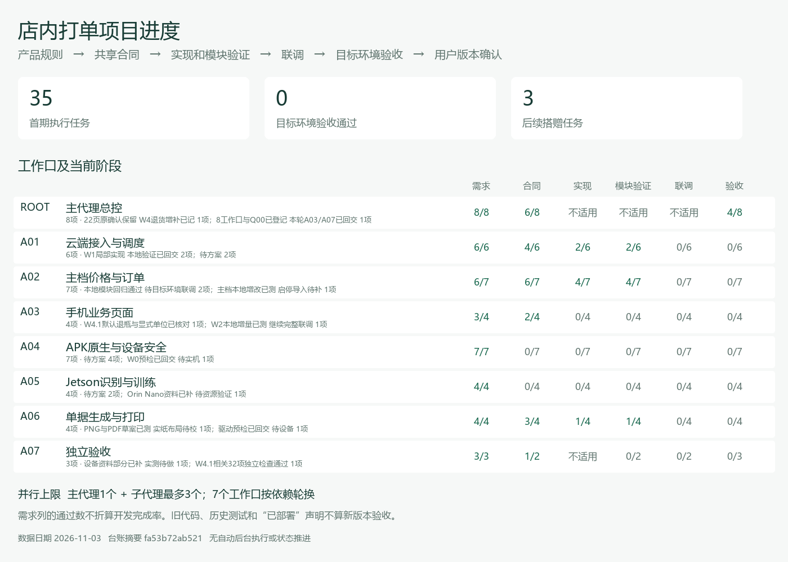
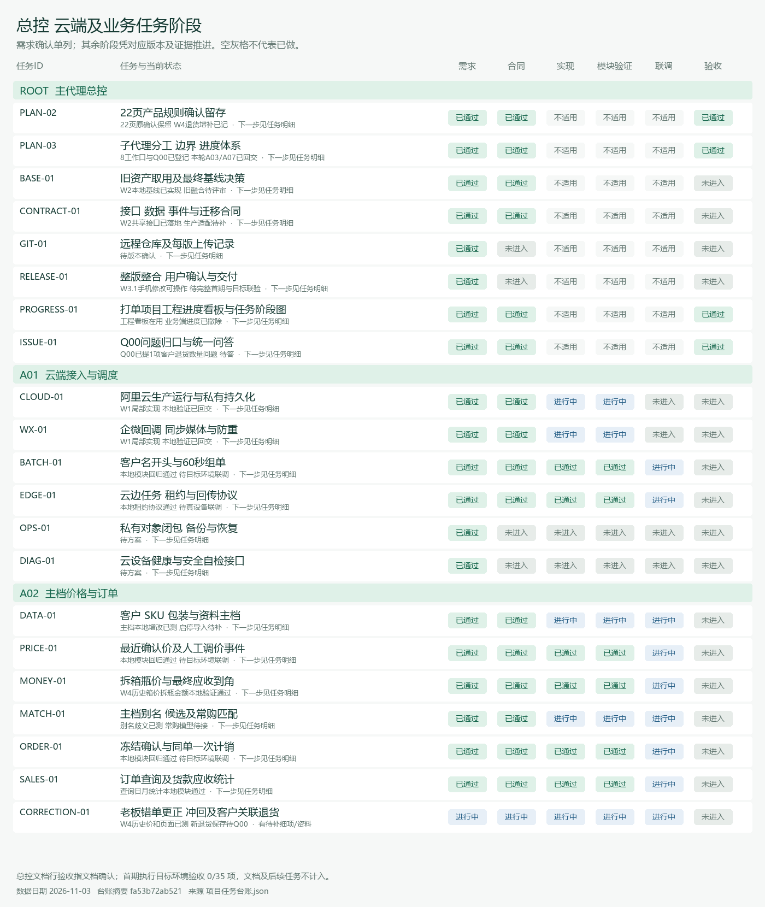
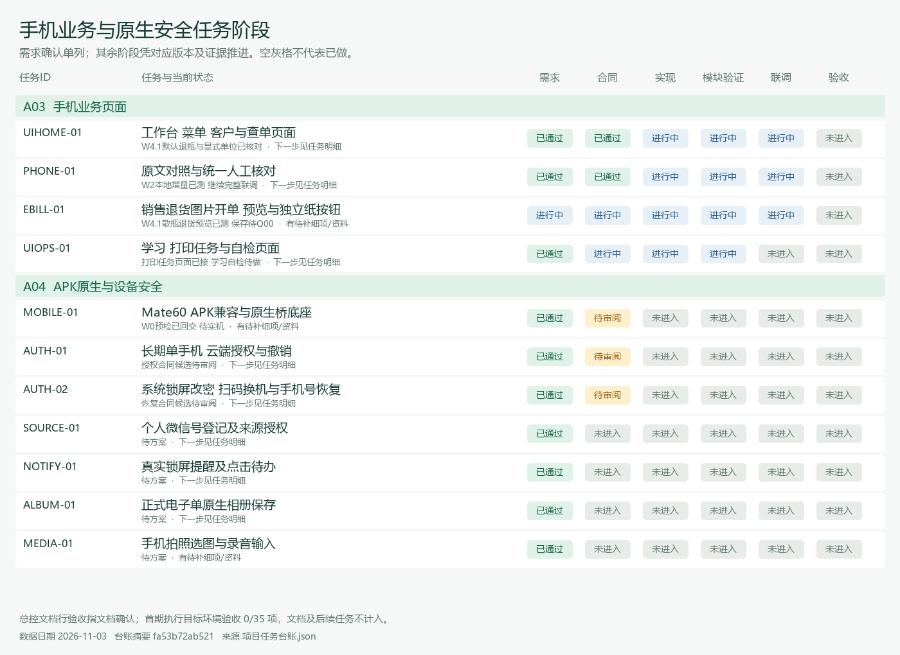
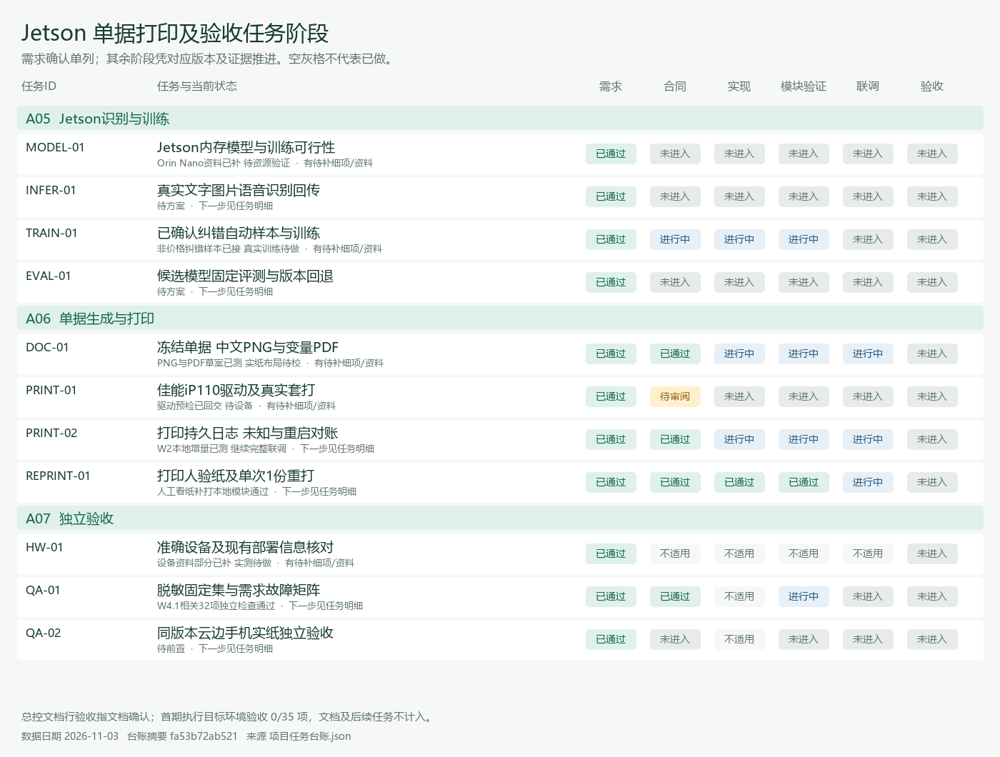
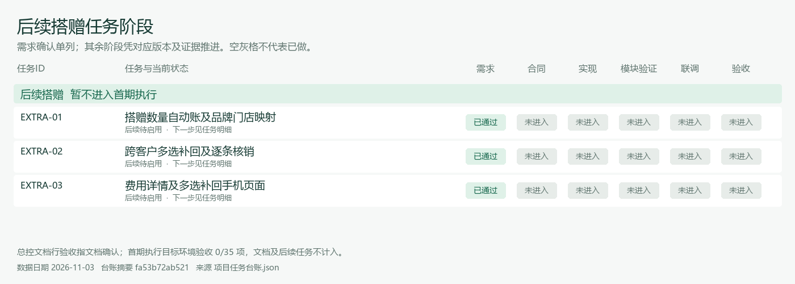

# 项目进度看板

更新日期：2026-11-03；方案mgmt-v0.8.1；台账摘要`fa53b72ab521`。

当前：W4.1退货默认瓶、散瓶/整箱按钮常显与最少1瓶已实际核对；32项相关测试通过，保存仍待Q00数量策略；前轮完整142Node+11Python记录保留，目标设备未验收。**首期执行验收通过 0/35项**。需求确认不折算开发完成率，旧工程只作为参考，真实任务状态以下图及台账为准。

## 常用入口

- [子代理分工和批次](01_子代理分工与任务交接.md)
- [项目边界](02_项目边界与执行规范.md)
- [完整任务明细](03_完整任务明细.md)
- [依赖关系图](05_任务依赖关系.md)
- [交接模板](04_任务交接模板.md)
- [唯一状态源 JSON](项目任务台账.json)

## 每项任务的阶段图

每行一个任务，列为需求、合同、实现、模块验证、联调、目标环境验收。灰色未进入，绿色有证据通过，黄色待审阅；不适用的阶段单独标明。文档类与后续任务不计入首期执行分母。

### 总控 云端及业务

### 手机页面 原生及安全

### Jetson 单据打印及验收

### 后续搭赠

## 当前待补信息

- CORRECTION-01：Q-RETURN-CUSTOMER-LIMIT-01：是否按客户累计已购减已退限制数量，待Q00用户答复
- EBILL-01：Q-RETURN-CUSTOMER-LIMIT-01：新客户退货正式保存关闭，待数量策略
- MOBILE-01：用户报告系统7.0.0.109及API26.0.0；完整系统名称、APK/原生兼容仍待实机核实，不能推断Android API26
- MEDIA-01：微信及企微客服实际链路、手机入口的媒体限制数值与适用范围待A01/A04核验（用户口径已确认）
- MODEL-01：用户已报Orin Nano和Ubuntu22.04.5；JetPack/CUDA/可用内存与设备实测尚缺
- TRAIN-01：训练频率/样本数/资源上限未填写
- DOC-01：数量列、抵扣/合计位置及超行分页细项待明确
- PRINT-01：iP110连接方式、驱动及真实进纸未验证
- HW-01：JetPack/L4T及实际可用资源待测；iP110连接/驱动和当前云事实待核；手机7.0.0.109/API26.0.0已有，系统全称与兼容待实测

以上按台账登记，资料解决后由ROOT清除对应blockers并刷新；不要求重批整套页面。

## 谁来更新 怎么刷新

ROOT在子任务回交时读取证据，更新台账的status、各stage、evidence、source_version、日期和next_action，再运行项目工具`tools/render_project_progress.py`。它只校验台账和重建Markdown/SVG/PNG，不执行任务、不联网、不自动把状态变通过。用户可直接查看这个文件和图，无需启动服务器。

台账是单一来源，不直接编辑生成图片或另维护完成率。通过阶段要有实际证据；实现及之后阶段还须源码版本。状态改变或证据撤回后重新绘图即可。没有截止期不画虚构日期甘特图，也不创建定时自动运行。
