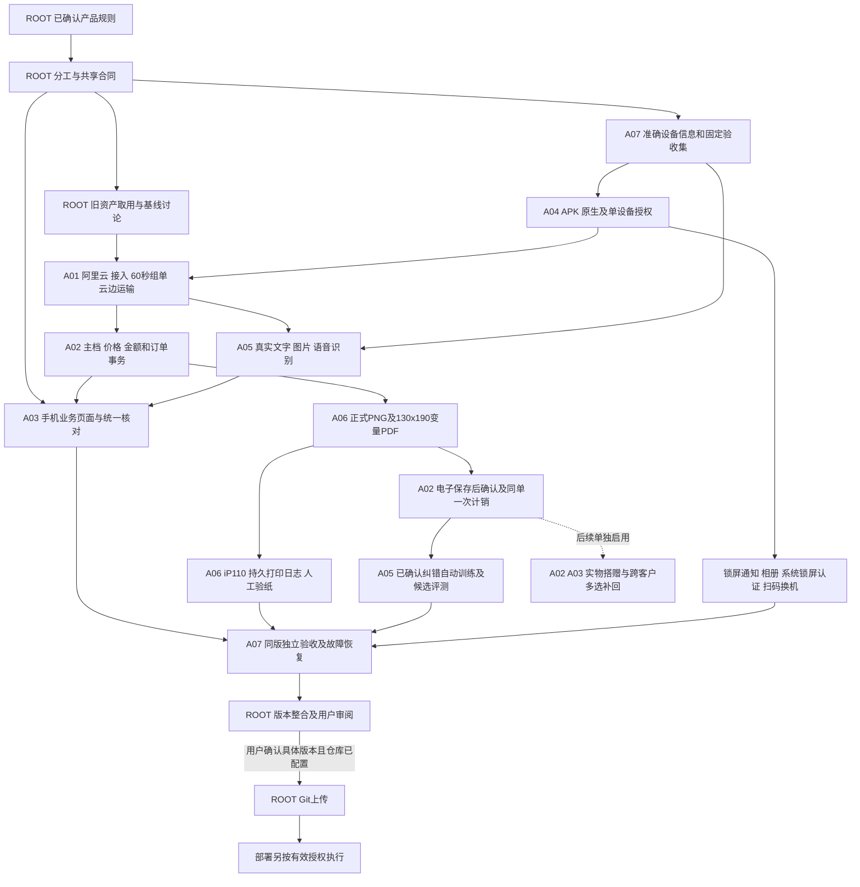

# 任务依赖关系

本图表示工作先后和协作，不含虚构工期。详细到每个任务的依赖由《项目任务台账.json》和《03_完整任务明细.md》给出。合同明确后可先做独立设计/模拟；最终联调不能跳过真实依赖。

图中“主档/订单事务”和“单据完成”的拆分是为了说明A02与A06交界，不代表两套订单权威。A02拥有唯一业务确认和计销；A06只生成单据和执行打印。

现场关键前置：HW-01准确设备信息；MODEL-01模型内存及训练可行性；MOBILE-01华为APK兼容；PRINT-01真实驱动/纸张；SOURCE-01个人微信号与平台来源绑定。没有资料时先登记待资料，不把旧历史当当前通过。

正式环境部署、真实数据迁移、模型训练运行和真实打印均按用户对对象和范围的有效授权执行；这张依赖图只列计划，不自动运行。
